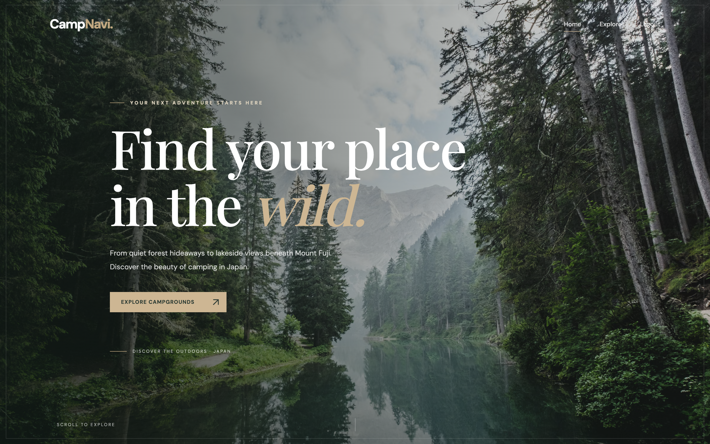
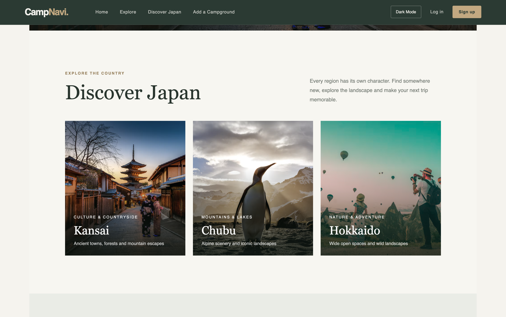
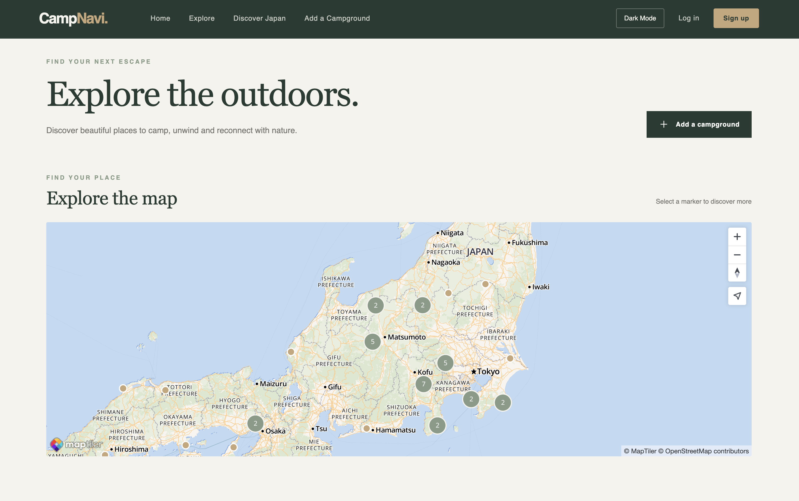
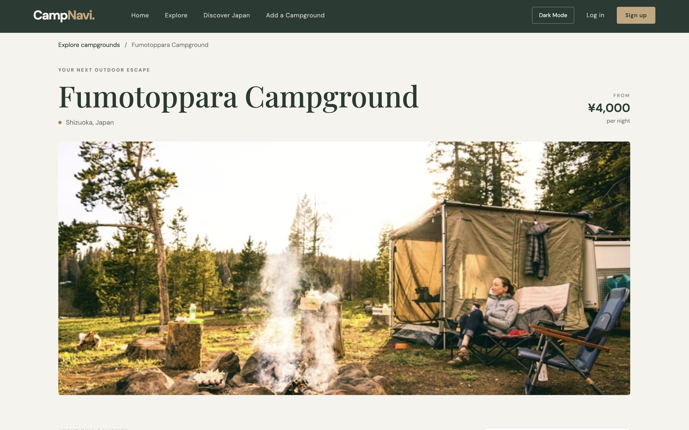

# Camp-Navi

**Explore Japan. Find your next campsite.**

Camp-Navi is a full-stack campground discovery and management application inspired by camping and travel in Japan. Users can explore campground listings, view detailed information, read reviews, and manage their own listings.

Built with Node.js, Express, MongoDB and EJS, the project demonstrates full-stack development through authentication, authorisation, database relationships, CRUD operations, image management and server-side rendering.

**Live Demo:** [camp-navi.vercel.app](https://camp-navi.vercel.app)

**GitHub Repository:** [github.com/mjsdev7/Camp-Navi](https://github.com/mjsdev7/Camp-Navi)

---

## Features

- Browse campground listings across Japan
- Discover destinations through the Discover Japan page
- View detailed campground information, images, prices and locations
- User registration and authentication
- Authorisation for campground and review actions
- Create, edit and delete campground listings
- Submit, edit and delete reviews where authorised
- Cloudinary image uploads and management
- MongoDB database integration using Mongoose
- Form validation and error handling
- Responsive layouts using Bootstrap
- Database seed scripts for campground data

---

## Screenshots

### Homepage



### Discover Japan



### Explore Campgrounds



### Campground Details



---

## Tech Stack

**Backend**

- Node.js
- Express.js
- MongoDB
- Mongoose
- EJS

**Frontend**

- HTML
- CSS
- JavaScript
- Bootstrap

**Authentication and Services**

- Passport.js
- Cloudinary
- MongoDB Atlas
- Vercel

---

## How It Works

### Campground Discovery

Users can browse campground listings across Japan and explore destination information. Each campground has a dedicated page with details such as images, pricing, descriptions and location information.

### Campground Management

Authenticated users can create campground listings. Listing owners can edit or delete their own campgrounds.

### Reviews

Authenticated users can leave reviews on campground listings. Authorisation checks control who can edit or delete reviews.

### Image Management

Campground images are uploaded and managed through Cloudinary, rather than stored directly in the application.

---

## Project Architecture

The application follows an MVC-style structure, separating database models, route handling, application logic and EJS views.

```text
Camp-Navi/
├── models/
├── routes/
├── controllers/
├── views/
├── public/
│   └── stylesheets/
├── seeds/
├── uploads/
├── utilities/
├── app.js
└── package.json
```

---

## Data Model

Campground records include:

- Title
- Images
- Price
- Description
- Location
- Author
- Reviews
- Geographic coordinates

---

## Running Locally

### 1. Clone the repository

```bash
git clone https://github.com/mjsdev7/Camp-Navi.git
cd Camp-Navi
```

### 2. Install dependencies

```bash
npm install
```

### 3. Configure environment variables

Create a `.env` file in the project root and add the credentials required by the application:

```text
DB_URL=your_mongodb_connection_string
CLOUDINARY_CLOUD_NAME=your_cloudinary_name
CLOUDINARY_KEY=your_cloudinary_key
CLOUDINARY_SECRET=your_cloudinary_secret
```

Use your own credentials. Check the application configuration for any additional environment variables required by your local setup.

### 4. Seed the database (optional)

```bash
node seeds/index.js
```

This runs the project's seed script to populate the database with campground data.

### 5. Start the application

```bash
node app.js
```

### 6. Open the application

Visit:

http://localhost:3000

---

## Key Learnings

Through this project, I developed practical experience with:

- Building server-side applications using Node.js and Express
- Designing MongoDB schemas and relationships with Mongoose
- Structuring an application using the MVC pattern
- Creating RESTful routes and CRUD functionality
- Implementing authentication and authorisation
- Managing user-generated content and reviews
- Integrating Cloudinary for image management
- Rendering dynamic pages using EJS
- Validating forms and handling application errors
- Deploying an application using Vercel

---

## Future Improvements

Potential areas for further development include:

- More advanced campground search and filtering
- Enhanced campground recommendations
- Further improvements to the mobile experience

---

## About the Project

Camp-Navi was built as a personal full-stack development project to apply and strengthen my web development skills through a practical application.

The project brought together backend development, database design, authentication, image management and frontend development in one complete campground discovery experience.
